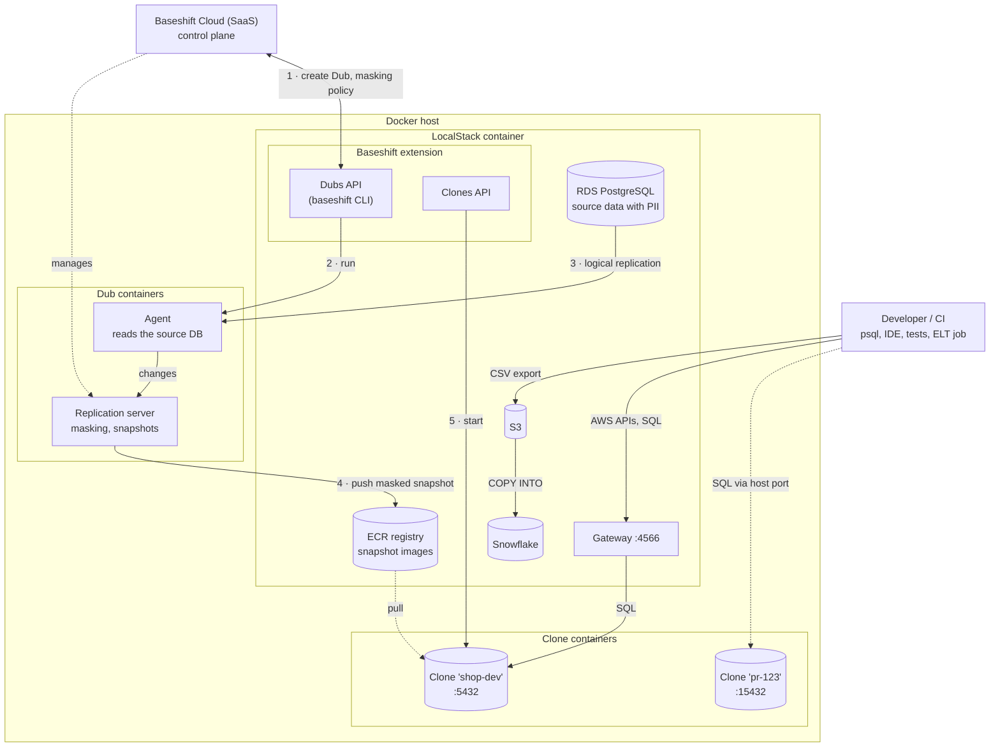

# Baseshift on LocalStack

This repo contains a [LocalStack Extension](https://github.com/localstack/localstack-extensions) that runs a [Baseshift](https://baseshift.com) database clone next to LocalStack.

Baseshift creates masked, writable clones of your production database (PostgreSQL or MySQL) for development and testing. With this extension, your application code running in LocalStack (e.g., Lambda functions or ECS tasks) can work against a realistic, anonymized copy of your data, all on your local machine.

For PostgreSQL clones, the database is available through the LocalStack gateway (`localhost.localstack.cloud:4566`), as well as on the regular host port `5432`.

## Architecture



The extension runs inside the LocalStack container, and starts the Baseshift containers next to it on the same Docker host:

1. The **Dubs API** of the extension uses the `baseshift` CLI, logged in with a Baseshift user, to create a Dub (the replicated source database) in Baseshift Cloud, and to set its masking policy.
2. It runs the Baseshift self-hosted components as **Dub containers**: the agent, and the replication server. Both are managed via the Baseshift Cloud control plane. Alternatively, the components can run in a LocalStack EKS cluster (see [Self-hosted Dubs](#self-hosted-dubs)).
3. The agent replicates the source database, e.g. PostgreSQL in LocalStack RDS with PII, via logical replication. The replication server applies the masking policy, and maintains a masked replica.
4. The replication server pushes masked Docker **snapshot images** to the LocalStack ECR registry.
5. The **Clones API** starts clones from these images as **clone containers**: a default clone at startup (`BASESHIFT_IMAGE`), and further clones on demand. Each clone is a writable copy of the masked database.

Steps 1-4 are optional: if your Dub runs elsewhere (e.g., in your AWS account), clones can also be started from its snapshot images directly (see [Getting the clone image](#getting-the-clone-image)).

App code running in LocalStack (e.g., Lambda functions or ECS tasks) and developer tools only ever see masked data. They connect to a clone through the LocalStack gateway (the first PostgreSQL clone is detected by its protocol handshake on port 4566), or to the host port of a clone. An ELT job can export data from a clone to S3, and load it into Snowflake (see the [demo](demo/)).

## Prerequisites

- Docker
- LocalStack Pro (free trial available)
- [`lstk`](https://docs.localstack.cloud/aws/developer-tools/running-localstack/lstk/) CLI (`npm install -g @localstack/lstk`)
- A Baseshift account, with either:
  - a Dub and a Docker snapshot (clone image) of it, and the AWS CLI for pulling the image from ECR, or
  - a Baseshift user, for creating [self-hosted Dubs](#self-hosted-dubs) in LocalStack
- `make`

## Getting the clone image

Baseshift clone images are private to your organization, and are stored in an AWS ECR repository. In the Baseshift dashboard, select your Dub and click **Get docker snapshot** to get the commands for authenticating to ECR and pulling the image, for example:

```bash
aws ecr get-login-password --region <region> | \
  docker login --username AWS --password-stdin <account-id>.dkr.ecr.<region>.amazonaws.com
docker pull <account-id>.dkr.ecr.<region>.amazonaws.com/<repository>:latest
```

The image needs to be pulled on the host **before** starting LocalStack, as the extension does not authenticate against ECR. Note that ECR logins expire after 12 hours.

See the [Baseshift docs on local clones](https://docs.baseshift.com/docs/clones/local-clones) for more details.

## Install from GitHub repository

`lstk` does not have commands for managing extensions, but LocalStack can install the extension at startup via the `EXTENSION_AUTO_INSTALL` config variable:

```bash
LOCALSTACK_EXTENSION_AUTO_INSTALL="git+https://github.com/localstack/localstack-extensions.git#egg=localstack-baseshift&subdirectory=baseshift" \
LOCALSTACK_BASESHIFT_IMAGE=<account-id>.dkr.ecr.<region>.amazonaws.com/<repository>:latest \
  lstk start
```

Alternatively, if you are using the legacy `localstack` CLI:

```bash
localstack extensions install "git+https://github.com/localstack/localstack-extensions.git#egg=localstack-baseshift&subdirectory=baseshift"
```

## Install local development version

To install the extension into LocalStack in developer mode, you will need Python 3.11, and create a virtual environment in the extensions project.

In the newly generated project, simply run

```bash
make install
```

Developer mode currently requires the legacy `localstack` CLI, as `lstk` does not support extensions yet. To enable the extension for LocalStack, run

```bash
localstack extensions dev enable .
```

You can then start LocalStack with `EXTENSION_DEV_MODE=1` to load all enabled extensions (the `localstack` CLI mounts the extension sources into the container):

```bash
EXTENSION_DEV_MODE=1 LOCALSTACK_BASESHIFT_IMAGE=<clone-image> localstack start
```

## Usage

### Default clone

Start LocalStack with `BASESHIFT_IMAGE` pointing to your clone image, and (if one was configured when creating the Dub) the encryption password:

```bash
LOCALSTACK_BASESHIFT_IMAGE=<account-id>.dkr.ecr.<region>.amazonaws.com/<repository>:latest \
LOCALSTACK_BASESHIFT_ENCRYPTION_PASSWORD=<encryption-password> \
  lstk start
```

The clone (named `default`) is started in the background once LocalStack is ready. Connect to it, for example with `psql`. Local clones do not require a password; use one of the database users replicated from your source database:

```bash
# through the LocalStack gateway
psql -h localhost.localstack.cloud -p 4566 -U <user> <database>

# or directly on the host port
psql -h localhost -p 5432 -U <user> <database>
```

From inside LocalStack (e.g., Lambda functions), connect to `localhost.localstack.cloud:4566`.

### Clones API

Clones can also be started and stopped on demand (e.g., one clone per pull request or coding agent), via the API at `http://baseshift.localhost.localstack.cloud:4566/clones`:

```bash
# start a clone
curl -X POST http://baseshift.localhost.localstack.cloud:4566/clones \
  -d '{"name": "pr-123", "image": "<clone-image>"}'

# list clones, with their status and endpoints
curl http://baseshift.localhost.localstack.cloud:4566/clones

# get / stop a clone
curl http://baseshift.localhost.localstack.cloud:4566/clones/pr-123
curl -X DELETE http://baseshift.localhost.localstack.cloud:4566/clones/pr-123
```

The request accepts `name` (lowercase letters, digits, and dashes), `image`, and optionally `dbType` (`postgres` or `mysql`) and `env` (additional environment variables for the clone container). Clones start asynchronously - their `status` changes from `starting` to `running` (or `failed`, with an `error` message).

Each clone gets its own host port. The first PostgreSQL clone gets port `5432` and is also available through the LocalStack gateway; further clones get ports from `15432` upwards (see the `endpoints` in the API response).

### Clone images in LocalStack ECR

Clone images can also be served by the LocalStack ECR registry, e.g., to share snapshot images within a team, or to emulate the full Baseshift flow locally:

```bash
lstk aws ecr create-repository --repository-name baseshift/my-dub
docker tag <clone-image> 000000000000.dkr.ecr.us-east-1.localhost.localstack.cloud:4566/baseshift/my-dub:latest
docker push 000000000000.dkr.ecr.us-east-1.localhost.localstack.cloud:4566/baseshift/my-dub:latest

curl -X POST http://baseshift.localhost.localstack.cloud:4566/clones \
  -d '{"name": "my-dub", "image": "000000000000.dkr.ecr.us-east-1.localhost.localstack.cloud:4566/baseshift/my-dub:latest"}'
```

The LocalStack ECR registry does not require a `docker login`.

### Self-hosted Dubs

The extension can also create self-hosted Dubs, and run their Baseshift components (agent and replication server) in LocalStack. This way, the full flow runs locally: the source database (e.g., in LocalStack RDS) is replicated and masked by the Baseshift components, which push encrypted Docker snapshots to the LocalStack ECR registry, from where clones are started. The components are managed via Baseshift Cloud, which requires a Baseshift user - configure its credentials when starting LocalStack:

```bash
LOCALSTACK_BASESHIFT_USER_EMAIL=<email> \
LOCALSTACK_BASESHIFT_USER_PASSWORD=<password> \
  lstk start
```

Then create a Dub for a source database. The extension uses the `baseshift` CLI (logged in with these credentials) to create the Dub, and runs the components as containers next to LocalStack (or in a LocalStack EKS cluster, see `deployment` below), configured for LocalStack. Creating a Dub takes a few minutes, until the components are connected, the health checks have passed, and the initial snapshot is pushed to LocalStack ECR:

```bash
# create a Dub (source: e.g., an RDS instance, as seen from LocalStack)
curl -X POST http://baseshift.localhost.localstack.cloud:4566/dubs \
  -d '{"name": "my-dub", "hostname": "localhost.localstack.cloud", "port": 4510,
       "database": "shop", "username": "admin", "password": "<db-password>"}'

# get the status, progress log, and latest snapshot image of the Dub
curl http://baseshift.localhost.localstack.cloud:4566/dubs/my-dub

# take a new snapshot
curl -X POST http://baseshift.localhost.localstack.cloud:4566/dubs/my-dub/snapshots

# update the masking policy (restarts the Dub, which re-creates the masked replica and takes a new snapshot)
curl -X POST http://baseshift.localhost.localstack.cloud:4566/dubs/my-dub/masking \
  -d '{"manual_rules": [{"table": "shop.public.customers", "column": "email", "masking_function": "random_email_gen"}]}'

# start a clone from the latest snapshot of the Dub
curl -X POST http://baseshift.localhost.localstack.cloud:4566/clones \
  -d '{"name": "pr-123", "dub": "my-dub"}'
```

The request accepts `name`, `hostname`, `port`, `database`, `username`, `password`, and optionally `engine` (default `postgres`), `encryptionPassword` (for the snapshot images, letters and numbers only, default `localstack123`), `maskingPolicy` (in the format of `baseshift dub masking get`, see below), and `deployment`:

- `docker` (default): the components run as plain containers next to LocalStack (`ls-baseshift-dub-<name>-repserver` and `-agent`), attached to the LocalStack network. This starts faster and needs fewer resources than a Kubernetes cluster.
- `kubernetes`: the components run in a LocalStack EKS cluster (`baseshift`), installed with the Baseshift Helm chart.
 The `status` of the Dub changes from `creating` to `deploying` and `connecting`, and finally to `ready` (or `failed`, with an `error`, see the `log` for details).

Without a masking policy, the Dub replicates the data unmasked. A masking policy has a rule per column (`table` is `database.schema.table` for PostgreSQL), with masking functions such as `full_name_gen`, `first_name_gen`, `last_name_gen`, `random_email_gen`, `anon_email`, `street_address_gen`, `random_city_gen`, `zip_code_gen`, `company_name_gen`, `varchar_random`, `md5`, `sha256`, `string_const`, or `setnull` (see the masking policy in the Baseshift dashboard for all functions). See [`demo/masking-policy.json`](demo/masking-policy.json) for an example.

Notes:

- Dubs are created in your Baseshift organization, and cannot be deleted via the CLI. The credentials of the components (Helm values) are stored in the LocalStack volume directory (`lib/baseshift`). The replication server enrolls with a one-time token, and keeps its certificates on its data volume: with the `docker` deployment, the data volumes are kept across restarts, so the Dub can be re-created with the same name after a restart. The EKS cluster (and its volumes) is removed with LocalStack, hence use a new Dub name with the `kubernetes` deployment after a restart.
- The replication server builds the snapshot images on top of base images from the Baseshift ECR registry in AWS. The extension configures the LocalStack DNS server to resolve these names upstream (instead of pointing them to LocalStack).
- The components need about 2 CPUs and 3 GiB of memory, and a few GB of disk space for the images.

### MySQL clones

Set `BASESHIFT_DB_TYPE=mysql` (or `"dbType": "mysql"` in the API) for MySQL clones. MySQL clones are only available on their host port (`3306` for the first one): unlike PostgreSQL, the MySQL protocol starts with the server sending a greeting, so MySQL connections cannot be told apart from other traffic on the gateway port `4566`.

### Environment Variables

- `BASESHIFT_IMAGE`: Image of the default clone to start once LocalStack is ready (optional, clones can also be started via the API)
- `BASESHIFT_DB_TYPE`: Database engine of the default clone, `postgres` (default) or `mysql`
- `BASESHIFT_ENCRYPTION_PASSWORD`: Encryption password defined when the Dub was created (passed to the clones as `PASSWORD`)
- `BASESHIFT_USER_EMAIL` / `BASESHIFT_USER_PASSWORD`: Credentials of the Baseshift user to create [self-hosted Dubs](#self-hosted-dubs) with
- `BASESHIFT_BIND_HOST`: Host interface the clone ports are published on (default `127.0.0.1`). Clones are copies of production data and accept connections without a password, so only set this to `0.0.0.0` if you need remote access and the host is not reachable by untrusted parties
- `BASESHIFT_CLONE_<NAME>`: Passed to the clone containers as `<NAME>`, for the [advanced clone options](https://docs.baseshift.com/docs/clones/local-clones#advanced-configuration), e.g. `BASESHIFT_CLONE_BACKUP_SCHEDULE`, `BASESHIFT_CLONE_MAX_BACKUPS`, or `BASESHIFT_CLONE_SPACE_USAGE_MIN_PERCENT`

Note: When starting LocalStack via `lstk` (or the `localstack` CLI), prefix environment variables with `LOCALSTACK_` to forward them to the container, e.g. `LOCALSTACK_BASESHIFT_IMAGE`.

### Limitations

- PostgreSQL connections on the gateway port are detected by their protocol handshake. Running this extension together with another extension that serves PostgreSQL on the gateway (e.g., ParadeDB) is not supported.
- The clone ports are published on the host, so they must not be in use by another database.

## Demo

The [`demo/`](demo/) directory contains an end-to-end demo of masked production data flowing through a local pipeline: a "production" database in LocalStack RDS, a masked snapshot image in LocalStack ECR, a clone started via this extension, and an ELT pipeline into the LocalStack Snowflake emulator.

## Change Log

- `0.1.0`: Initial release of the extension

## License

This project is licensed under the Apache License, Version 2.0.
